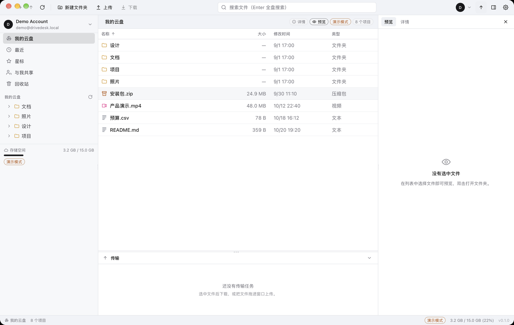
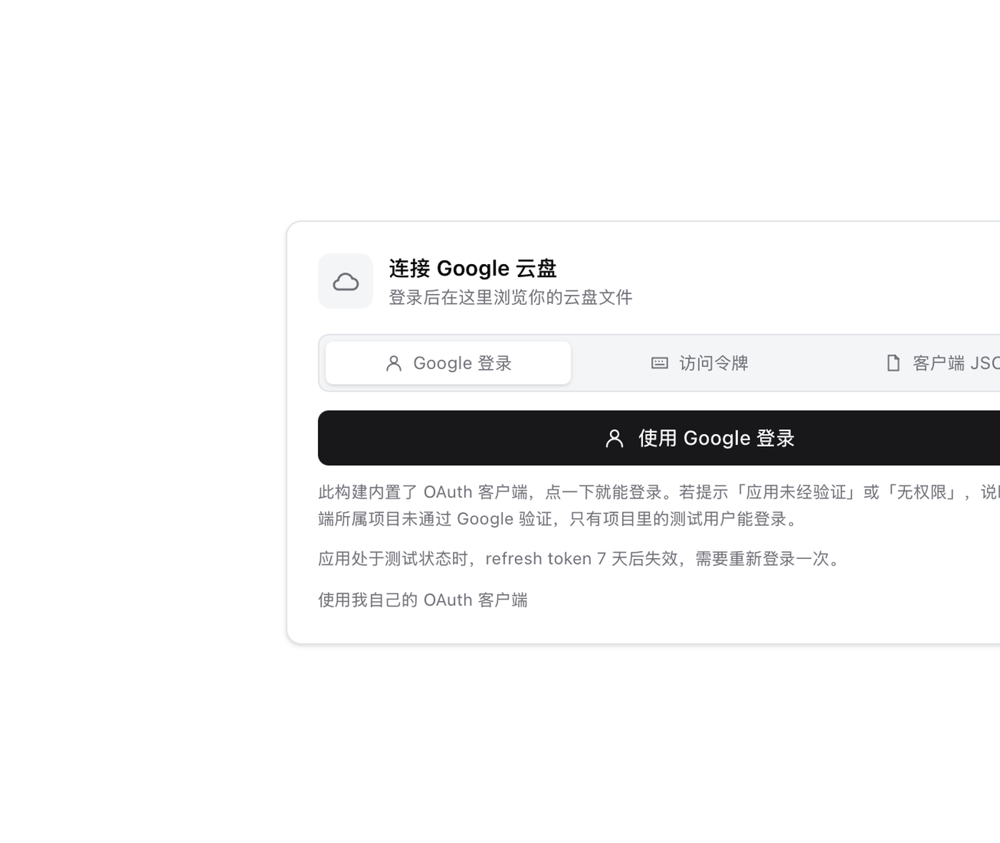

# DriveDesk

[](https://github.com/dousha0w0/drivedesk/actions/workflows/ci.yml)
[](https://github.com/dousha0w0/drivedesk/releases)

一个轻量的 Google Drive 桌面客户端：**Tauri 2 + Vue 3 + Tailwind v4**，界面逻辑沿用 DBX 那套工作台（设计变量 / 双布局 / 可拖拽面板 / 虚拟表格 / 标签式导航），后端用 Rust 直连 Drive REST API，凭据进系统凭据库。



演示模式（`DRIVEDESK_MOCK=1`）无需 Google 账号即可完整运行：浏览、搜索、排序、预览、下载、上传、新建/重命名/移动/回收站都是真实代码路径，只是远端换成了确定性的内存云盘。

---

## 功能

**浏览**
- 我的云盘（懒加载目录树）、最近、星标、与我共享、回收站
- 面包屑、后退/前进、上一级、当前文件夹筛选、**Enter 全盘搜索**（`name contains` + `fullText contains`）
- 列排序（名称自然序 / 大小 / 修改时间 / 类型，文件夹始终优先）、虚拟滚动（万级条目只渲染可视窗口）
- 多选：单击、⌘/Ctrl 切换、Shift 连选、⌘A 全选；键盘 ↑↓ / Enter / Space / Backspace / Delete
- 右键菜单：预览、下载、重命名、创建副本、移动、加星、复制链接、复制 ID、详情、移入/恢复/永久删除

**预览与详情**
- 文本（前 512 KB，等宽渲染）、图片（含 SVG）、PDF（内嵌）、视频/音频
- Google 文档/表格/幻灯片导出为 PDF 预览；Office 文档下载后用系统应用打开
- 右侧面板可切「预览 / 详情」，详情含类型、大小、所有者、时间、位置、MD5、文件 ID（一键复制）

**传输**
- 下载队列：并发数可调、进度/速度/ETA、取消、重试、断点续传（HTTP Range）、按 MD5/尺寸校验
- 上传：8 MiB 分块 resumable session、重试、取消即终止会话、同名自动 `name (2).ext`
- 文件夹下载：递归展开并保持目录结构
- 传输坞：折叠/拖高、批量清除已完成、下载完成可直接打开所在目录

**外壳**
- 两套布局：**经典紧凑**（连续工具栏）/ **现代分隔**（凹槽 + 每块面板独立圆角）
- 侧栏、右栏、传输坞均可拖拽调宽/高，尺寸持久化
- 主题：浅色/深色/跟随系统 × 3 套配色（中性 / 石墨 / VS Code）× 3 种圆角；行密度舒适/紧凑
- 中英双语；macOS 使用 Overlay 标题栏 + 红绿灯内嵌，窗口隐藏到前端首帧就绪再显示
- 拖文件进窗口上传；全局快捷键（⌘A/⌘F/⌘R/⌘,、⌘Backspace 回收站）

**账号与安全**
- Google Desktop OAuth + PKCE + loopback 回调；刷新令牌存 macOS Keychain / Windows DPAPI / Linux Secret Service（无凭据库时退化为 0600 文件并在设置里标出）
- 多账号、切换、退出；`drive` scope（读取 + 写入 + 回收站）
- 预览文件走 Tauri asset protocol，WebView 拿不到任何 Google URL 或 token

---

## 快速开始

### 1. 演示模式（无需账号）

```sh
pnpm install
pnpm build:ui
cargo build --manifest-path src-tauri/Cargo.toml
DRIVEDESK_MOCK=1 ./src-tauri/target/debug/drivedesk
```

开发模式（热更新）：

```sh
pnpm dev                      # Vite, 127.0.0.1:1420
DRIVEDESK_MOCK=1 cargo run --manifest-path src-tauri/Cargo.toml
```

> 调试构建走 `devUrl`，需要 Vite 在 1420 上运行；发布构建会把 `dist/` 嵌进二进制。

### 2. 连接真实 Google Drive

**方式 A：一键登录（构建里内置 OAuth 客户端）**

```sh
pnpm bundle:with-client ~/Downloads/client_secret_xxx.json
```

脚本会校验文件是「桌面应用」类型、打印脱敏后的 client_id，然后以注入的环境变量执行 `pnpm tauri build`。`--check` 只校验不构建；其余参数原样传给 tauri（例如 `--bundles app`）。等价的手工写法：

```sh
DRIVEDESK_GOOGLE_CLIENT_ID=xxxx.apps.googleusercontent.com \
DRIVEDESK_GOOGLE_CLIENT_SECRET=yyyy \
pnpm tauri build
```

这样打出来的包，启动就是一张登录页：主按钮是「使用 Google 登录」，点一下进浏览器选账号即可，用户完全不需要碰 GCP。工具栏在没有账号时也会常驻一个「登录」按钮，头像菜单里的「添加账号」仍然可用。



没有内置凭据的构建不会出现这颗按钮，而是显示「导入 OAuth 客户端 JSON」＋配置链接——这是构建设置的差异，不是入口缺失：内置凭据由 `DRIVEDESK_GOOGLE_CLIENT_ID/SECRET` 在构建（或启动）时提供。开发时用运行时环境变量也能达到同样效果，不必重编：

```sh
DRIVEDESK_GOOGLE_CLIENT_ID=... DRIVEDESK_GOOGLE_CLIENT_SECRET=... cargo run --manifest-path src-tauri/Cargo.toml
```

**方式 B：访问令牌（1 小时，适合立刻试功能）**

不想碰 GCP 时最快的路：打开 [OAuth Playground](https://developers.google.com/oauthplayground)，在 Step 1 勾选 `https://www.googleapis.com/auth/drive`（或直接粘进 Scope 框），Authorize 后点「Exchange authorization code for tokens」，复制 **Access token**；回到登录页展开「使用访问令牌（快速测试）」，粘贴即可。

- 令牌约 1 小时有效，没有 refresh token，过期后重新粘一个；应用会提示「访问令牌无效或已过期」。
- 令牌只存系统凭据库，不出现在日志、URL 或 IPC 之外的地方。
- 只适合自测，不能作为发行版的登录方式。

**方式 C：用户自带客户端**

1. 在 [Google Cloud Console](https://console.cloud.google.com/) 建项目并启用 **Google Drive API**。
2. 按 [创建凭据指南](https://developers.google.com/workspace/guides/create-credentials) 创建 **桌面应用（Desktop app）** 类型的 OAuth 客户端，下载 JSON。
3. 打开 DriveDesk → 右上角账号 → 添加账号 → 选这个 JSON，浏览器完成授权。

三条路径共用同一套代码（同一份 `Backend`、同一套 Drive 调用），只在「怎么拿到 bearer token」上不同。`client_id/secret` 与刷新令牌都由应用自己保存（JSON 复制到数据目录，令牌进凭据库）。

#### 一键登录不是万能的：Google 的验证规则

内置客户端 = 内置的是**某个具体 Google Cloud 项目**的 OAuth 客户端。桌面应用的 `client_secret` 按 Google 的定义是公开的，所以打包没风险；真正的限制在项目状态：

| 发布状态 | 谁能登录 | refresh token 寿命 | 代价 |
| --- | --- | --- | --- |
| Testing | 只有「测试用户」名单里的账号，**硬上限 100** | **7 天**，过期需重新登录 | 免费，5 分钟 |
| Published + 未验证 | 任意账号可进，但敏感/受限 scope 仍有 **100 用户硬上限**，并显示危险警告 | 长期 | 官方明确「strongly discouraged」 |
| Published + 已验证 | 任意账号，无警告 | 长期 | Drive 是受限 scope：品牌/权限验证 + 年度 CASA 安全评估 |

依据：[OAuth app state overview](https://developers.google.com/identity/protocols/oauth2/production-readiness/overview)、[token 过期规则](https://developers.google.com/identity/protocols/oauth2#expiration)。

所以：

- **自己/小团队用**：建项目 → 同意屏加测试用户 → 用方式 A 打包，体验就是「下载即登录」。7 天重新登录一次。
- **公开给任意用户**：要么完成受限 scope 验证，要么保持方式 B（让用户建自己的客户端）。
- 别把别人的 client ID 打进自己的包：Google 会按客户端归属追责，也能随时撤销。

另两条经验值得记住：

- **桌面客户端的 `client_secret` 本来就是公开的**：Google 对 installed app 的定义是「无法保守秘密的 public client」，所以把它写进二进制/开源仓库是正常做法（[官方说明](https://developers.google.com/identity/protocols/oauth2/native-app)）。真正要保护的是 refresh token，它在系统凭据库里。
- **别指望一个 client_id 全世界共用**：rclone 多年提供 shared client_id，如今官方提示它会在 2026 年内停用，改用自带 client（[rclone 文档](https://rclone.org/drive/)）。所以要么各自建客户端，要么把自己的项目做到验证通过。

这条限制不是实现问题——应用侧代码已经就绪（`account_login_quick`），换一个已验证的 client_id 就自动升级为全量可用。

### 3. 构建产物

```sh
# 本地打包需要更新签名私钥（见“自动更新”），否则 updater 产物无法生成
TAURI_SIGNING_PRIVATE_KEY=/path/to/updater.key pnpm tauri build
```

手工 `cargo build --release` 时必须加 `--features custom-protocol`，否则内嵌的 `dist/` 不会被 `tauri://localhost` 提供，窗口会是空白；`pnpm tauri build` 会自动带上。

### 4. 发布新版本

```sh
node scripts/bump-version.mjs 0.2.0      # package.json / tauri.conf.json / Cargo.toml
# 在 CHANGELOG.md 写 ## [0.2.0] 段落（会成为 release body 和应用内更新日志）
git commit -am "release: v0.2.0" && git tag v0.2.0 && git push --tags
```

推 tag 后 `.github/workflows/release.yml` 会在 macOS arm64/x64、Linux、Windows 上并行打包，签名 updater 产物，汇总成 `latest.json` 并发布 Release。

## 自动更新

- 客户端用 `tauri-plugin-updater`：启动 4 秒后静默检查一次（可在设置里关掉），也可以手动“检查更新”。
- 更新源是 `https://github.com/dousha0w0/drivedesk/releases/latest/download/latest.json`，只有**已发布**的 Release 才会被看到（draft 不算）。
- 安装包用 minisign 公钥校验（`tauri.conf.json → plugins.updater.pubkey`），私钥只存在于 GitHub Secrets。
- 更新弹窗直接展示 Release 的正文（来自 `CHANGELOG.md` 对应版本段落），包含版本号、发布时间、下载进度，装完自动重启。
- 设置页可查看当前版本、上次检查时间、忽略的版本并恢复提醒。

维护者一次性配置：

```sh
pnpm tauri signer generate -w ~/drivedesk-updater.key   # 已有则跳过
gh secret set TAURI_SIGNING_PRIVATE_KEY < ~/drivedesk-updater.key
gh secret set TAURI_SIGNING_PRIVATE_KEY_PASSWORD --body ""
# 可选：让发布版内置 OAuth 客户端，实现一键登录
gh secret set DRIVEDESK_GOOGLE_CLIENT_ID --body "xxxx.apps.googleusercontent.com"
gh secret set DRIVEDESK_GOOGLE_CLIENT_SECRET --body "GOCSPX-..."
```

**私钥丢失 = 已发版本无法再收到更新**，请离线备份。

---

## 架构

```
src/                        前端（Vue 3 + TS + Tailwind v4）
  App.vue                   外壳：工具栏 / 侧栏 / 工作区 / 右栏 / 传输坞 / 状态栏 / 快捷键 / 拖放
  components/layout/        FileTable(虚拟滚动) · FolderTree(递归) · PreviewPanel · TransferDock …
  components/ui/            手写的 7 个原语：Icon / Button / Modal / ContextMenu / Toast / Progress / Switch
  components/dialogs/       Login / Settings / Prompt / Confirm / Move
  stores/                   session · files · transfers · ui · dialogs（Pinia setup stores）
  lib/                      api(IPC 单点) · sort · selection · prefs · format · clipboard · smoke
  styles/                   tokens.css(设计变量) + globals.css(@theme inline + 组件样式)
  i18n/                     zh-CN / en（键集合有测试保证一致）
src-tauri/                  后端（Rust）
  types.rs                  IPC 数据结构（与 src/types/drive.ts 一一对应）
  auth.rs                   OAuth loopback + PKCE + 账号表 + 令牌刷新
  secrets.rs                Keychain / DPAPI / Secret Service / 0600 文件
  drive.rs                  Drive v3 客户端：list/get/create/rename/move/copy/trash/delete/export/quota
                            + 流式下载(Range 续传) + 8 MiB 分块上传 + 重试/退避 + 自然序排序 + 重名消歧
  backend.rs                Live / Mock 的单一接缝（命令层只认 Backend）
  mock.rs                   确定性演示云盘（含 PDF/PNG 生成器、40 张图、真实文件读写）
  transfer.rs               传输队列：并发、进度节流、取消、重试、文件夹展开、gdirect 路由
  preview.rs                预览缓存（按 id+修改时间），asset protocol 服务
  gdirect.rs                gdirect sidecar 适配（可选）
  commands.rs               IPC 命令表
  state.rs                  应用状态装配
```

数据流：

```
Vue 组件 → stores → lib/api.ts → invoke() → commands.rs → Backend(Live|Mock) → Drive REST
                                            ↘ transfer.rs → 事件 drive://transfer → stores/transfers
```

几条刻意的边界：
- **命令层无业务**：`commands.rs` 只做参数搬运，Live/Mock 由 `Backend` 一个 enum 分流，所以演示模式不会走另一套 UI 代码。
- **传输在 Rust 侧**：WebView 只收进度事件，关掉/切走界面不影响下载；限速、续传、并发都在进程内。
- **UI 偏好留在 WebView**（localStorage，首帧前由 `index.html` 回放），**后端偏好留在 Rust**（下载目录、并发、gdirect），避免互相等待。
- **预览不把字节塞进 IPC**：落盘到缓存后返回绝对路径，前端用 `convertFileSrc` 打开。

---

## 沿用了 DBX 的哪些 UI 逻辑

| DBX 的做法 | DriveDesk 的落地 |
|---|---|
| Tailwind v4 CSS-first（无 config）+ `@theme inline` 映射设计变量 | `src/styles/tokens.css` + `globals.css`，同一套 `--background/--primary/...` 命名 |
| 少量 shadcn 原语 + 大量自研领域组件 | `components/ui` 只有 7 个原语，其余全是业务组件；图标是手写 path，不引图标库 |
| 两套布局：`classic` / `separated`（`app-panel-gutter` + `dbx-panel`） | `data-layout` + `.app-pane`，分隔模式用 `gap:6px;padding:6px` + 每块圆角 |
| 面板拖拽：7px 热区、三点握把、宽度持久化 | `composables/useResizeHandle.ts` + `localStorage`（移动时只改内存，松手才落盘） |
| 虚拟滚动表格（万级行） | `FileTable.vue`：`translateY` 绝对定位 + 可视窗口切片 + ResizeObserver |
| 单 shell + 「表面」而非路由 | 无 vue-router；`files.target` 决定列表语义，面板/弹窗用状态机 |
| 传输坞 / 底部插件坞 | `TransferDock.vue`（可折叠、可拖高） |
| 启动前主题回放 + WebView 兼容提示 | `index.html` 内联脚本先刷主题，旧 WebView 不会白屏闪一下 |
| Pinia + vue-i18n + 单一 IPC 入口 | 同；`lib/api.ts` 是唯一 invoke 封装，命令名与 `commands.rs` 逐一对应 |

没有照搬的部分（Drive 没有对应心智）：SQL 编辑器 / 结果集分栏、多编辑器分组、驱动商店、AI 面板、MQ/Schema 工具。标签化只保留在「表面切换」层面，没有做真正的多标签拖动。

---

## gdirect 集成（可选）

[gdirect](https://github.com/mizorewww/gdirect) 是 **GPL-2.0-or-later** 的独立命令行程序（Rust + libaria2，带 Google IP 扫描 / SNI 改写），适合受限网络。DriveDesk **不链接、不内嵌、不复制**它的代码：

- 设置里填 gdirect 路径并打开开关后，**下载/上传**改为 `spawn` 本地 `gdirect` 进程：
  - 下载：`gdirect download <id> -o <path> -j N [--export MIME]`，进度通过轮询目标文件大小得到（gdirect 没有结构化进度输出）。
  - 上传：`gdirect upload <file> --parent <id> --name <name>`，解析 stdout 的 `id\tname`。
- 浏览/搜索/重命名等仍走 DriveDesk 自己的 Drive API 与账号 —— 两边凭据不共享，gdirect 需要单独 `gdirect login`。设置页对此有明确提示。
- gdirect 不支持文件夹展开，文件夹下载仍由 DriveDesk 递归后逐个文件交给它。
- 分发时若一并提供 gdirect 二进制，需要遵守 GPL：附带其源码获取方式与许可证文本。DriveDesk 自身代码不因此变成 GPL。

---

## 安全说明

- OAuth 使用 loopback `127.0.0.1:0` + PKCE(S256) + `state` 校验，回调页只回一行 HTML，不接收外部输入。
- 刷新令牌只存系统凭据库；账号索引（邮箱/昵称）是普通 JSON，不含密钥。
- IPC 命令对文件 id 做字符白名单校验；`system_open_url` 只允许 http(s)。
- 预览缓存按 `id + 修改时间 + 大小` 命名，改名/改内容自动失效；`cache_clear` 清空。
- WebView 关掉了 CSP（Tauri 默认模板），但页面不渲染远端 HTML：文本预览按纯文本插入，不使用 `v-html`。

---

## 验证

```sh
cargo test --manifest-path src-tauri/Cargo.toml   # 21 项：排序/重名/查询构造/PDF 生成/凭据文件名/传输命名…
pnpm test                                          # 43 项：选择模型/排序/格式化/偏好清洗/Google 错误映射/登录面板/更新弹窗/平台判定/错误映射/i18n 键覆盖
pnpm exec vue-tsc --noEmit                         # 类型检查
```

端到端冒烟（真实应用窗口 + 真实 Rust 后端 + 演示云盘，23 步）：

```sh
pnpm test:smoke           # 跑 release 二进制，逐条打印 PASS/FAIL，失败退出码非 0
```

也可以手工指定环境变量（`DRIVEDESK_MOCK=1 DRIVEDESK_SMOKE=1 DRIVEDESK_SMOKE_OUT=/tmp/smoke.json DRIVEDESK_BIN=...`）。

它按顺序驱动 store（与用户操作同一路径）：账号 → 根目录 → 进入 40 项的「照片」→ 返回 → 图片预览（含 asset protocol 真解码）→ 按大小排序 → 过滤 → 文本预览 → 下载（轮询到 done 且字节数 > 0）→ 上传一份冒烟临时文件并确认云端出现 `smoke-upload.txt` → 新建/重命名/移入回收站/永久删除 → 全盘搜索 → 两套布局切换 → 状态栏与表格行确实在 DOM 里。报告写到 `DRIVEDESK_SMOKE_OUT` 并打印 `SMOKE_RESULT {json}`，然后退出。

---

## 许可证

MIT，见 `LICENSE`。通过子进程调用的 gdirect 是独立的 GPL-2.0-or-later 程序，不随本项目分发。

## 已知限制

- **缩略图**：列表用类型图标而非 Drive 缩略图（`thumbnailLink` 需要带 token 代理，未实现）。
- **共享与权限**：可看「与我共享」和复制链接，不能改 ACL、不能管理共享云端硬盘（Shared Drives）。
- **同步**：没有 `changes` feed / 离线缓存，列表以打开时拉取为准。
- **永久删除**：回收站外没有「删除」入口；团队盘（Team Drive）元数据只做了 `supportsAllDrives` 基础兼容。
- **平台**：macOS 上完整验证（含窗口截图与冒烟）；Windows/Linux 代码路径齐全但未在真机跑过，Windows 会保留系统标题栏（配置只对 macOS 用了 Overlay）。
- **更新签名**：macOS/Windows 安装包没有代码签名证书（Apple notarization / Authenticode），首次打开会有系统警告；updater 的 minisign 签名是独立的一套，已经配好。
- **gdirect**：只做传输，进度是文件大小轮询；需要用户自己装好并登录。
